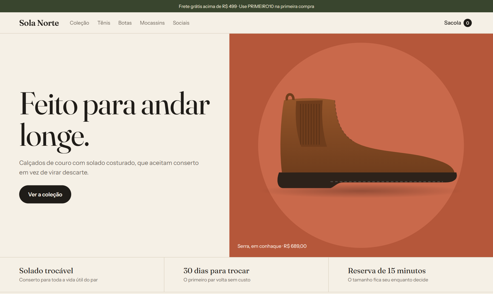
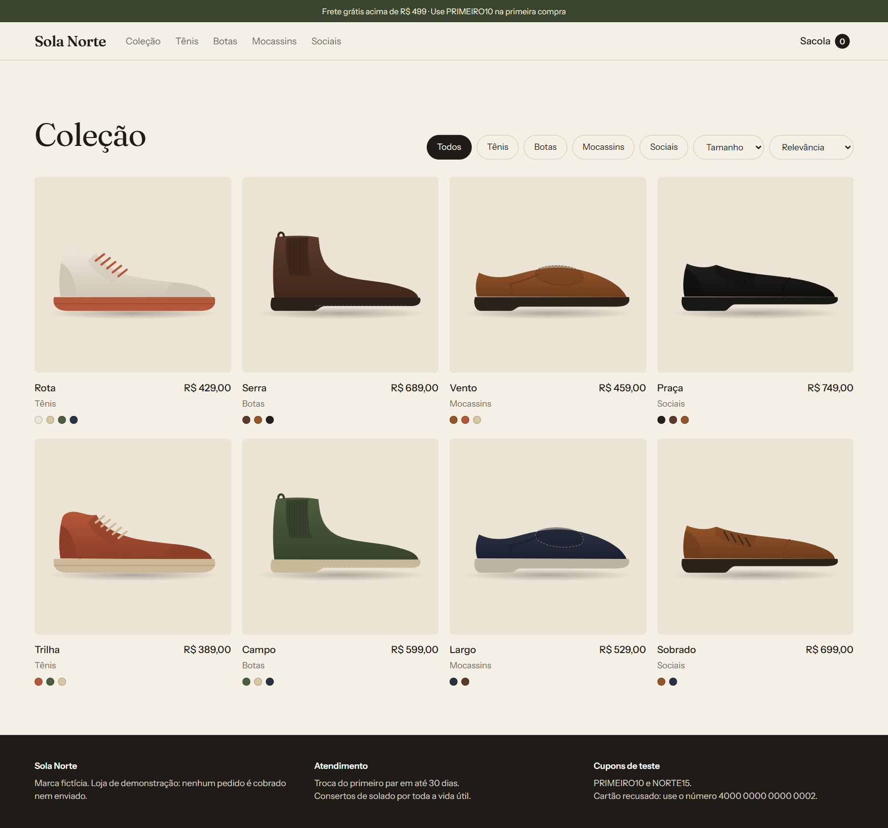
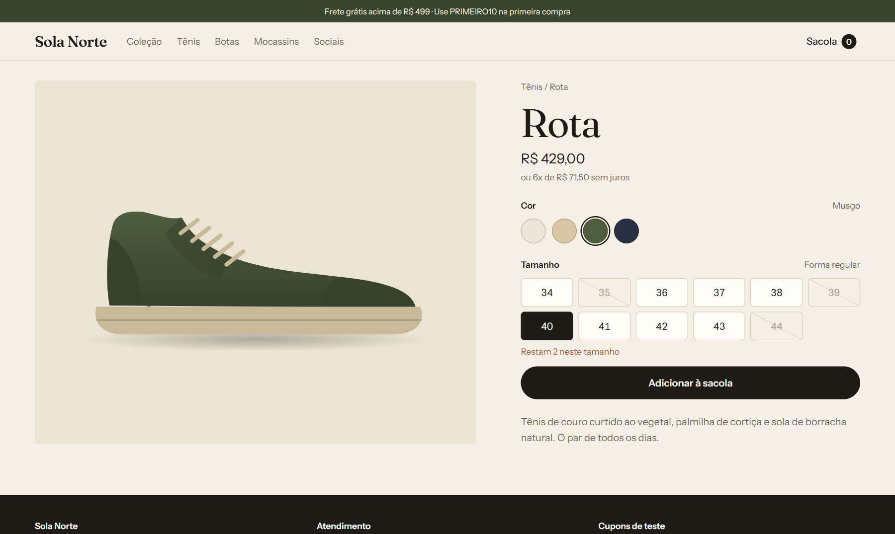
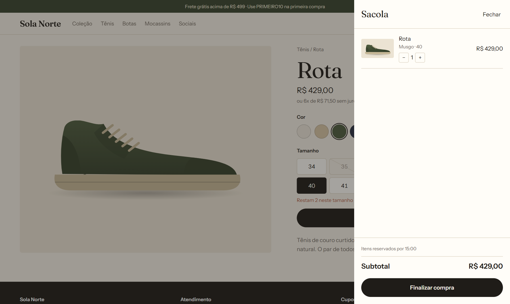
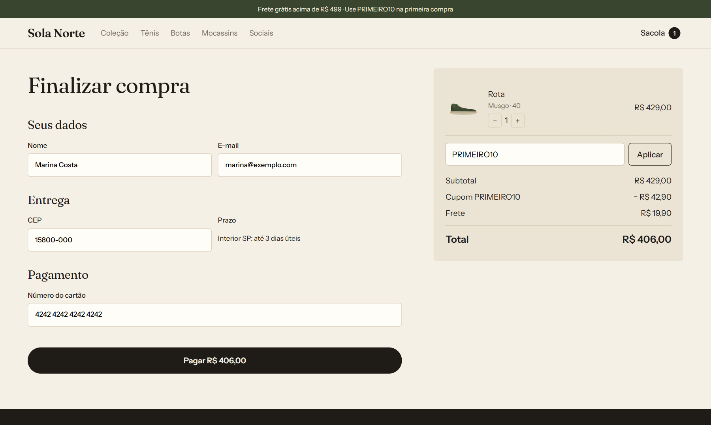
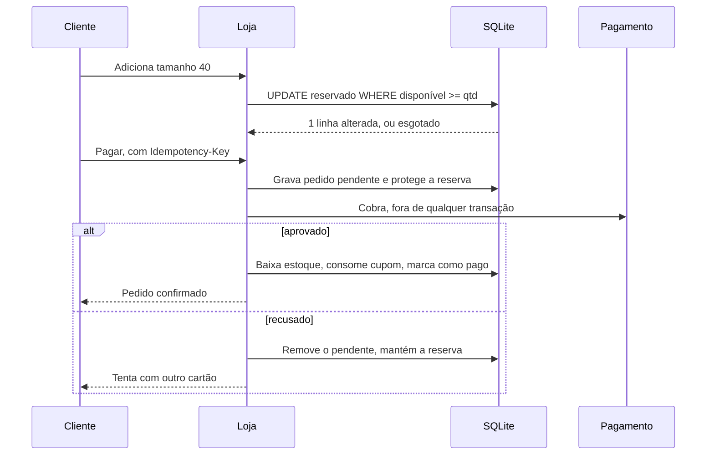

# Sola Norte

E-commerce de calçados com reserva de estoque, checkout idempotente e front próprio, sem framework. A marca é fictícia; a engenharia do carrinho é a parte séria. TypeScript, Node 24, SQLite, zero dependências.

[](https://github.com/luizrenatodc/loja-sola-norte/actions/workflows/testes.yml)
[](LICENSE)

**[Abrir a loja](https://luizrenatodc.github.io/loja-sola-norte/)** na versão estática. Nada é cobrado nem enviado.



| Coleção | Produto |
|---|---|
|  |  |

| Sacola com reserva | Checkout |
|---|---|
|  |  |

## O problema que o projeto resolve

Uma loja parece um CRUD até o último par do tamanho 40 entrar em dois carrinhos ao mesmo tempo, ou o cliente clicar duas vezes em "Pagar" com a rede oscilando. Os três riscos tratados aqui são:

| Risco | Solução |
|---|---|
| Vender além do estoque | Reserva atômica com `UPDATE` condicional, reforçada por `CHECK` no banco |
| Carrinho abandonado prender estoque | Reserva de 15 minutos, devolvida automaticamente ao vencer |
| Cobrar duas vezes | Chave de idempotência única no pedido |

## Fluxo do pedido



## Decisões técnicas

**A garantia contra venda excessiva fica no banco.** A reserva é um único `UPDATE ... WHERE estoque - reservado >= ?`. Ler, comparar e depois gravar abriria uma janela de corrida. O `CHECK (reservado <= estoque)` é a segunda linha de defesa, caso uma mudança futura erre a condição.

**A cobrança nunca roda dentro de uma transação.** Um gateway lento seguraria a trava de escrita e pararia a loja. Por isso o pedido é gravado como pendente, a cobrança ocorre fora, e só depois o estoque é baixado.

**`BEGIN IMMEDIATE` em toda escrita.** Pega a trava de escrita no início e evita a falha de upgrade de leitura para escrita quando há mais de um processo.

**Dinheiro em centavos inteiros.** Nenhuma conta usa ponto flutuante, e o arredondamento do desconto acontece em um único lugar.

**Recusa não consome a chave.** O pendente é removido, então o cliente pode tentar outro cartão no mesmo checkout sem perder o tamanho reservado.

**Sapatos em SVG por camadas.** Cada modelo é desenhado uma vez e recebe a cor da variante, então trocar a cor no produto não baixa nenhuma imagem.

## Testes

São 12 testes, incluindo:

- **Concorrência real:** oito processos Node disputam 20 pares no mesmo arquivo de banco, e o resultado precisa ser exatamente 20 reservas. Como o `node:sqlite` é síncrono, um teste dentro de um único processo não provaria nada.
- Expiração e renovação de reservas, com relógio injetado.
- Idempotência: a mesma chave não chama o gateway duas vezes.
- Recusa de pagamento seguida de nova tentativa.
- Regras de frete, cupom e o fluxo completo pela API HTTP.

## Como rodar

Requer Node 24 ou superior. Não há nada para instalar.

```bash
npm start                # http://localhost:3000
npm test
node scripts/exportar.ts # atualiza o catálogo da versão estática
```

Cupons de teste: `PRIMEIRO10` e `NORTE15` (a partir de R$ 399). Para simular recusa, use um cartão terminado em `0002`.

## Estrutura

```text
src/loja.ts       regras de estoque, frete, cupom e pedido, sem HTTP
src/servidor.ts   API e arquivos estáticos
src/catalogo.ts   produtos e cores
docs/app.js       rotas e telas da loja
docs/api.js       mesma interface para servidor e versão estática
docs/sapatos.js   ilustrações SVG
test/             testes e o processo auxiliar de concorrência
```

## Limites conhecidos

- **A versão publicada é estática.** No GitHub Pages não há servidor, então o carrinho fica no navegador e as garantias de estoque não valem ali. Elas valem ao rodar `npm start`, que é o que os testes cobrem.
- **Janela de queda durante a cobrança.** Se o processo morrer entre cobrar e confirmar, o pedido fica pendente. Em produção, um job de reconciliação consultaria o gateway pela chave de idempotência. Esse job não existe aqui.
- **Corrida de chave repetida simultânea.** Dois pedidos com a mesma chave ao mesmo tempo têm um deles rejeitado pelo `UNIQUE` com erro genérico, sem devolver o pedido original.
- **Cupom validado antes da cobrança.** O último uso de um cupom pode ser disputado por dois checkouts simultâneos.
- **Pagamento simulado.** O número do cartão não sai do navegador; só um token de teste é enviado. Uma integração real usaria a tokenização do gateway.
- **SQLite atende um servidor.** Para várias máquinas, o mesmo `UPDATE` condicional funciona em Postgres.
- **Sem conta de cliente nem painel administrativo.**

## Sobre este projeto

Projeto de demonstração, com marca, produtos e dados fictícios, criado para mostrar a abordagem técnica.

## Autor

**Luiz Renato Carvalho**, Engenheiro de Software e IA · [luizrenato.dev](https://www.luizrenato.dev) · [LinkedIn](https://linkedin.com/in/luizrenatodc)
